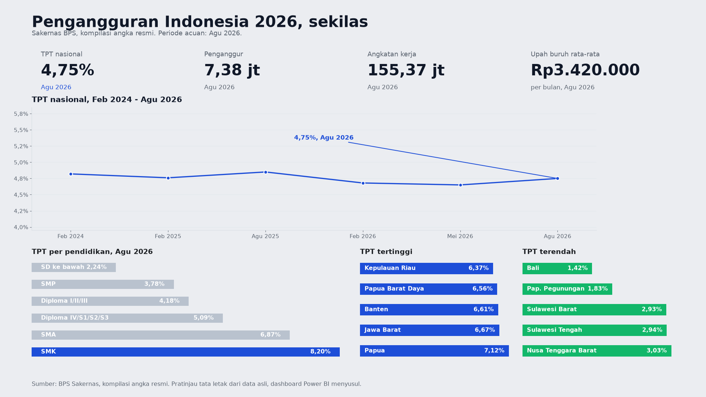

# Analisis Pengangguran Indonesia 2026

**Paradoks pendidikan: makin tinggi ijazah, makin tinggi pengangguran.**

> **Pernyataan data:** dataset ini **dikompilasi dari angka resmi BPS**
> (Survei Angkatan Kerja Nasional / Sakernas, via Berita Resmi Statistik
> dan publikasi yang mengutip BPS secara eksak). Tidak ada file CSV
> mentah Sakernas yang dapat diunduh publik — setiap angka dicatat
> bersama sumbernya di [`data/SOURCES.md`](data/SOURCES.md). Tidak ada
> satu pun angka yang dikarang; gap data ditandai eksplisit, bukan diisi.

## Temuan kunci (Agustus 2026, Sakernas BPS)

- **TPT nasional 4,75%** — turun 0,10 poin dari Agu 2025 (4,85%), meski
  naik tipis dari Mei 2026 (4,65%). Titik Agustus memang selalu sedikit
  lebih tinggi karena lulusan baru masuk pasar kerja.
- **Paradoks pendidikan:** lulusan **SMK 8,20%** — tertinggi dari semua
  jenjang, **1,73x rata-rata nasional** dan selisih **5,96 poin** dari
  lulusan SD ke bawah (2,24%). SMK turun secara tahunan (8,63% pada
  Agu 2025) tapi selalu memuncak di Agustus (9,01% pada Agu 2024).
  Lulusan SMA 6,87% dan Diploma IV/S1/S2/S3 5,09% juga di atas rata-rata
  nasional.
- **Pengangguran muda:** usia **15–24 tahun 17,50%** — naik 0,61 poin
  secara tahunan *saat semua kelompok umur lain turun*. 3,68x rata-rata
  nasional, 6,29x kelompok usia produktif (25–59 thn: 2,78%).
- **Kesenjangan wilayah & gender (Agu 2026):** perkotaan 5,53% vs
  perdesaan 3,45% (gap 2,08 pp); **perempuan 4,93% kini melampaui
  laki-laki 4,64%** — berbalik dari pola Februari 2026.
- **Jurang provinsi:** Papua 7,12% vs Bali 1,42% — **5,01x lipat**.
  Pusat industri pun tertekan: Jawa Barat 6,67%, Banten 6,61%,
  DKI Jakarta 5,75%. Kenaikan terbesar setahun: Papua Selatan
  +1,13 pp (4,04% ke 5,17%).
- **7,38 juta penganggur:** porsi terbesar lulusan **SMA 32,31%**
  (2,38 jt orang), lalu SMK 24,85% (1,83 jt) — **57,16% penganggur
  adalah lulusan sekolah menengah**.
- **Kualitas pekerjaan:** hanya **42,07% pekerja formal** (62,25 jt);
  57,93% informal. Setengah menganggur naik ke 8,68%, pekerja paruh
  waktu 23,85%, pekerja penuh 67,47%.
- **Upah naik:** rata-rata upah buruh Rp3,42 jt (Agu 2026) dari
  Rp3,39 jt (Mei 2026). Penyerap pekerja terbesar: pertanian
  41,73 jt orang, perdagangan 26,42 jt, industri 20,35 jt.

## Struktur proyek

```
pengangguran-2026/
├── analysis.ipynb            # notebook analisis
├── README.md
├── findings.json             # semua angka kunci (dihitung dari data)
├── data/
│   ├── compiled/            # 9 CSV kompilasi + SOURCES.md
│   ├── pengangguran_2026.db # hasil generate (git-ignored, bisa dibuat ulang)
│   └── SOURCES.md           # sumber per angka
├── sql/queries.sql           # 14 query verifikasi
├── scripts/
│   ├── analyze.py           # hitung findings.json (+assertion)
│   ├── load_to_sqlite.py    # CSV -> SQLite
│   ├── make_charts.py       # 10 chart PNG
│   └── build_powerbi.py     # rakit star schema powerbi/
├── charts/                   # 10 chart PNG
├── powerbi/                  # KIT DASHBOARD POWER BI
│   ├── fact_tpt_nasional.csv / fact_tpt_segmen.csv / fact_indikator.csv / fact_sektor.csv
│   ├── dim_periode.csv / dim_segmen.csv
│   ├── measures_dax.md      # measure siap tempel
│   ├── measures_dax_CATATAN_LEVEL.md  # BACA DULU: desain anti-jebakan
│   ├── dashboard_layout.md  # layout 4 halaman
│   └── build_guide.md       # langkah rakit di Power BI Desktop
├── requirements.txt
└── .gitignore
```

## Pratinjau dashboard



Pratinjau tata letak halaman 1 (Overview) yang dibuat langsung dari data asli
repo ini. Kit dashboard Power BI ada di `powerbi/`; GitHub tidak bisa me-render
file `.pbix`, jadi pratinjau ini yang tampil di halaman repo sampai dashboard-nya
selesai dirakit di Power BI Desktop.

## Cara reproduksi

```bash
~/workspace/mienv/bin/python scripts/analyze.py        # findings.json
~/workspace/mienv/bin/python scripts/load_to_sqlite.py # data/pengangguran_2026.db
~/workspace/mienv/bin/python scripts/make_charts.py    # charts/*.png
~/workspace/mienv/bin/python scripts/build_powerbi.py  # powerbi/*.csv
```

## Batasan

- TPT hanya mengukur pengangguran *terbuka*; setengah menganggur dan
  pekerja paruh waktu dicatat terpisah.
- TPT rendah pada lulusan SD bukan berarti pekerjaan lebih baik —
  mereka terserap ke informal karena tak bisa menunggu pekerjaan sesuai.
- Nilai Mei 2026 untuk gender & perkotaan/perdesaan tidak dipublikasikan
  di abstrak BRS (gap, tidak dikarang). Nilai provinsi Mei 2026 hanya
  untuk 17 provinsi; Agu 2026 lengkap untuk 38 provinsi (Lampiran 3
  BRS No. 113/11/Th. XXIX).
- Sakernas Agustus 2026 memakai KBLI 2025 (Agustus 2025 masih KBLI 2020),
  jadi rincian lapangan usaha antar kedua Agustus itu tidak sebanding
  langsung.
- Seri Papua 2022–2023 tidak sebanding dengan 2024+ (pemekaran provinsi).
